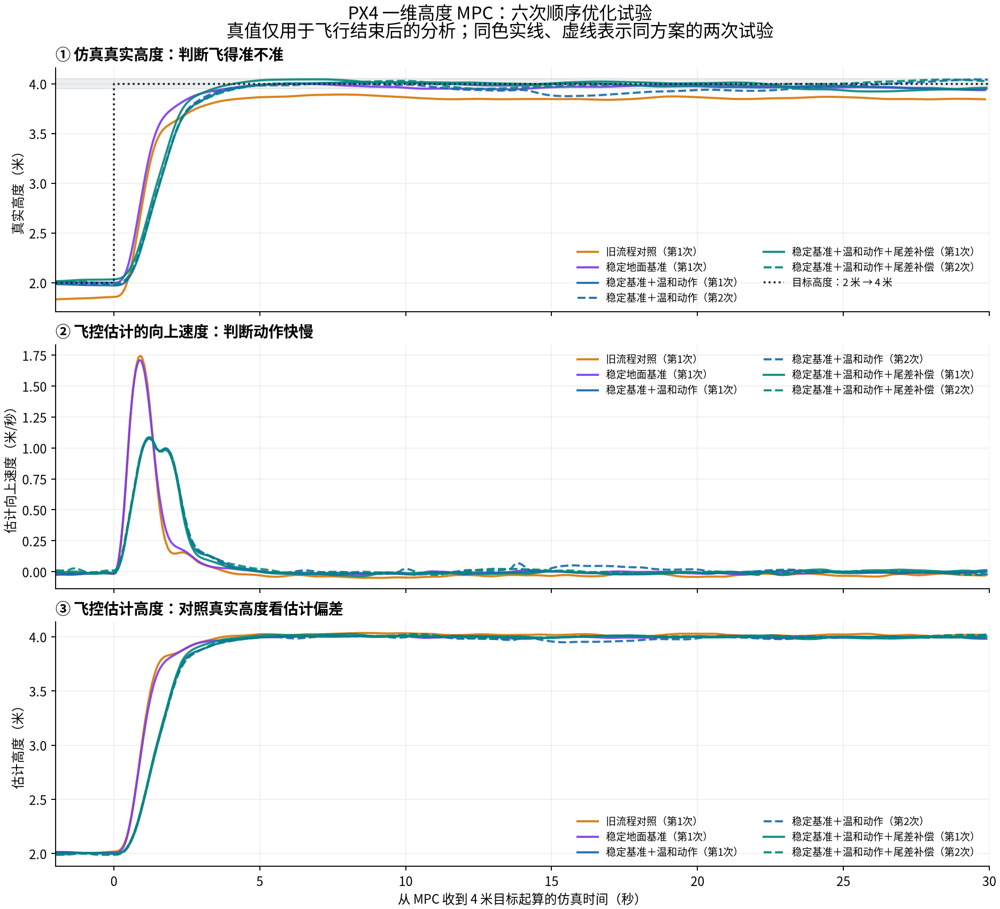

# PX4 四旋翼一维高度 MPC 仿真实验

基于 **PX4 SITL + Gazebo X500** 的高度阶跃控制实验。实现外部线性 MPC，通过 MAVLink 发送垂直加速度指令，比较模型标定、控制调度、地面高度基准和运动约束对响应的影响。

实验任务：完成起飞，在 2 m 悬停后将目标高度切换至 4 m，记录 30 s 仿真时间，最后降落并解除解锁。PX4 控制算法源码未改动；所有结果均来自仿真。



## 实验结果

最终配置为 **标定二状态模型 + 固定仿真时钟调度 + 稳定地面基准 + gentle 运动约束**；可选尾差补偿默认关闭。

| 指标 | 旧 MPC 流程（1 次） | 最终配置（2 次均值） |
| --- | ---: | ---: |
| 末段真实高度平均绝对误差 | 15.4 cm | 4.4 cm |
| 真实峰值垂直速度 | 1.74 m/s | 1.06 m/s |

地面基准稳定检查减小了高度原点误差；更温和的输入约束降低了峰值速度，代价是上升变慢。尾差补偿开、关各测试两次，未见稳定的真实末段精度收益，因此保留为可选功能。

这是 MPC 流程优化前后的探索性对照。旧配置只有一次试验，最终配置只有两次重复；其中一次最终试验未能在观察窗口内持续保持 ±5 cm。上述均值不是最大误差或置信区间，也不能据此认定 MPC 全面优于 PID。尚未进行实机、多工况和大样本验证。

- [完整实验记录与各阶段结果](RESULTS.md)
- [最终六次试验指标](results/20261027-flight-quality-pipeline/comparison.json)
- [中文图 PDF](deliverables/最终效果对比.pdf) · [离线 HTML 报告](deliverables/成果说明.html)（下载后用浏览器打开）
- [轻量实验归档 ZIP](deliverables/PX4高度MPC成果包.zip) · [归档校验清单](deliverables/成果清单.json)

## 控制结构

```text
高度目标 + EKF 高度/速度
          ↓
外部一维 MPC（10 Hz，预测未来 3 s）
          ↓ 垂直加速度指令，经 MAVLink / NED 坐标转换
PX4 加速度到推力 → 姿态控制 → 角速度控制 → 控制分配/电机
          ↓
Gazebo X500 动力学与传感器 → PX4 EKF → 下一次反馈
```

MPC 在 2 m 悬停阶段接管垂直位置与速度控制；横向位置、航向及起飞/降落继续使用 PX4。仿真真值仅用于事后评价，不参与控制反馈、模型标定或尾差补偿。

PX4 参数前缀 `MPC_` 表示多旋翼位置控制（Multicopter Position Control），与本仓库新增的模型预测控制器是不同概念。

## MPC 模型与约束

状态为地面相对高度 `h` 和向上速度 `v`，输入 `u` 为请求的净向上加速度：

```text
a = K·u + b
h[k+1] = h[k] + dt·v[k] + 0.5·dt²·a[k]
v[k+1] = v[k] + dt·a[k]
```

标定参数：`K = 1.5492651348831779`，`b = 0.041089602835091`。标定来源、训练及独立验证记录见 [模型配置](config/calibrated-altitude-model.json)。每次用当前状态求解凸二次规划，执行第一步输入，再滚动更新。

| 参数 | 最终配置 |
| --- | --- |
| 模型采样周期 / 预测步数 | 0.1 s / 30 步 |
| 预测速度软限制 | ±1.0 m/s |
| 请求加速度硬限制 | ±0.8 m/s² |
| 相邻输入变化上限 | 2.0 m/s³ × 0.1 s |
| 高度 / 速度权重 | 12 / 3 |
| 输入 / 输入变化权重 | 0.2 / 0.8 |
| 速度松弛权重 | 1000 |
| 末端代价 / 求解器 | 离散 LQR / OSQP |

速度允许通过松弛变量付出惩罚后超限；加速度和输入变化约束作用于求解指令。模型误差与执行器动态使实际运动不具有相同的严格边界。`MPCConfig()` 本身保留 standard 参数和名义模型；最终配置由实验入口加载标定模型并覆盖为 `gentle`。

## 核心实现

| 文件与位置 | 职责 |
| --- | --- |
| [altitude_mpc.py](scripts/altitude_mpc.py#L36) · `AltitudeMPC` | 二状态模型、预测矩阵、代价与约束 |
| [altitude_mpc.py:89](scripts/altitude_mpc.py#L89) · `solve()` | 更新 QP，求解并检查约束，返回第一步加速度 |
| [run_experiment.py:119](scripts/run_experiment.py#L119) | 调用 MPC、转换 NED 符号并发送 MAVLink 指令 |
| [run_experiment.py:409](scripts/run_experiment.py#L409) | 加载标定模型与最终运动参数 |
| [control_clock.py](scripts/control_clock.py) | 仿真时间调度与接收/求解/发送时序 |
| [flight_quality.py](scripts/flight_quality.py) | 地面稳定性检查及可选慢速尾差补偿 |
| [identify_altitude_model.py](scripts/identify_altitude_model.py) | 模型辨识与验证 |
| [analyze.py](scripts/analyze.py) | ULog 解析、响应与指标计算 |

起飞前至少等待 40 s 仿真时间，检查最近 10 s 的地面高度和垂直速度，连续通过 3 s 后取末段观测中位数作为地面基准。超时则不执行起飞。该措施不使用仿真真值。

## 复现环境与运行

验证环境为 Ubuntu 24.04 ARM64、PX4 v1.17.0（`d6f12ad1c4f70ad3230afd7d86e971421e02fef4`）、Gazebo Harmonic 8.15、ROS 2 Jazzy。Mac 通过 UTM 运行 Ubuntu；实验脚本也可在满足依赖的 Linux 环境执行，但其他配置尚未验证。

本仓库不包含 PX4 源码、已编译程序和系统依赖。已有环境须提供：

1. `vendor/PX4-Autopilot`：上述提交及所需子模块，已完成 `make px4_sitl_default` 构建。
2. ROS 2 Jazzy 与 Gazebo Harmonic，`/opt/ros/jazzy/setup.bash` 和 PX4 构建生成的 `gz_env.sh` 可用。
3. 项目根目录 `.venv`：安装 `requirements.txt`；中文图额外需要 Noto CJK 字体。依赖文件不是完整环境锁文件。
4. 启动脚本目前使用已登录的 Linux 图形桌面。UTM 原环境采用 Xorg + GLX + llvmpipe；不直接覆盖为硬件渲染。

环境准备和渲染诊断细节见 [EXPERIMENT_NOTES.md](EXPERIMENT_NOTES.md)。此仓库尚未提供从空白系统一键安装的流程。

在已配置的 Ubuntu 项目目录运行最终配置：

```bash
bash scripts/run-gazebo.sh   --controller mpc --mpc-model calibrated --timing-mode scheduled   --ground-init settled --motion-profile gentle --bias-compensation off
```

从 Mac 项目目录通过 SSH 调用已配置的虚拟机：

```bash
export PX4_LAB_VM='用户名@虚拟机地址'
bash scripts/run-on-vm.sh gazebo mpc calibrated scheduled settled gentle off
```

`PX4_LAB_VM` 必须按本机环境设置；包装脚本中保留的是原实验环境地址。Mac 与 VM 均需有项目目录，远端路径为 `~/px4-altitude-lab`。包装脚本同步脚本与配置，完成运行后拉回结果。实验入口在不指定 `--controller` 时默认使用 PX4 PID，复现 MPC 请保留完整命令。

命令会重建本项目专用 Gazebo 场景，执行完整飞行并生成新数据；不要同时启动两个实验。仅打开图形界面：`bash scripts/run-gazebo.sh --view-only`；停止项目后台进程：`bash scripts/stop-gazebo.sh`。

## 数据与验证

`results/` 按时间和方案保存试验。发布内容包括分析图、元数据、模型标定与调度对照，以及最终六次试验的 CSV/JSON 数据。历史失败记录保留用于审计，不计入正式六次对照。

- `response.csv`：统一坐标与时间的绘图数据；指标使用原始样本计算。
- `controller.csv` / `mpc-predictions.jsonl`：实际控制调度及预测记录。
- `metrics.json` / `events.json` / `parameters.json`：指标、事件和导出参数。
- [冻结代码与验证记录](results/20261027-flight-quality-pipeline/source-snapshot/verification.json)：六次完成降落、无 ULog 丢数据，EKF 参数一致，且真值未用于在线反馈。

原始 ULog、控制台日志、进程状态、虚拟机和第三方源码未上传；因此当前仓库可复查已导出的数据和图表，若要从原始 ULog 重新运行全部分析，需要另行保留的原始日志。

只重建报告和轻量归档，不启动飞行：

```bash
python3 scripts/package_results.py
```

控制器与时序测试（需要数值计算依赖，不启动 PX4）：

```bash
python -m unittest discover -s scripts -p 'test_*.py'
```

## 实验范围

目前只验证单一模型的 2→4 m 高度变化。未开展质量变化、风扰、横向耦合、不同电池/推力状态和长时间漂移测试；可选参考积分也不是完整的无静差 MPC。下一阶段可扩展重复试验、扰动注入与多工况统计。
