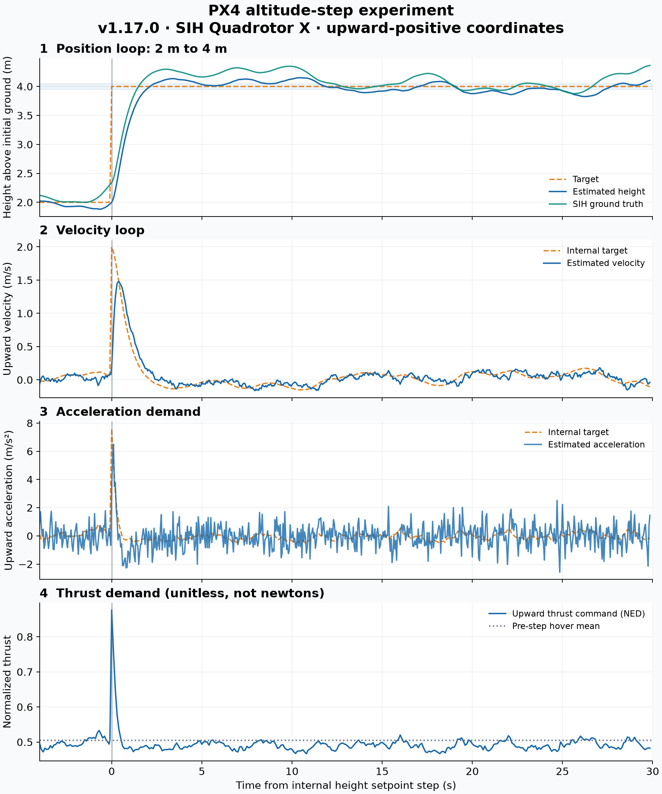
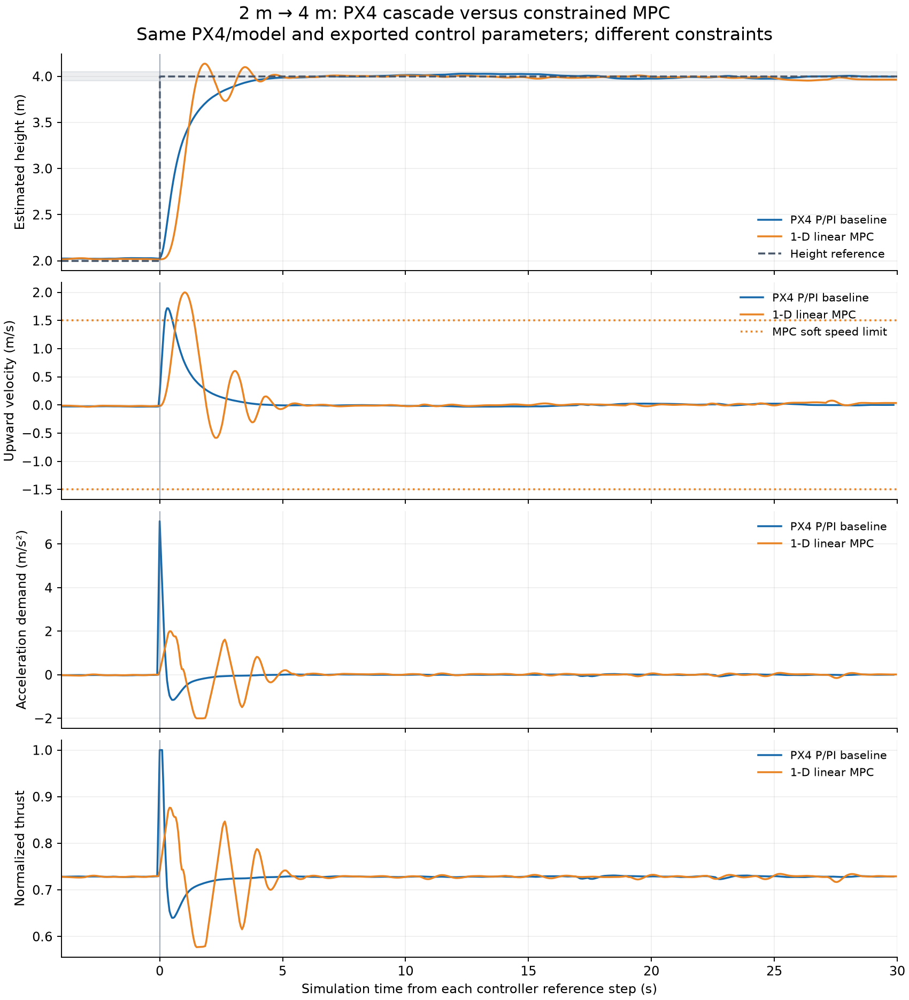
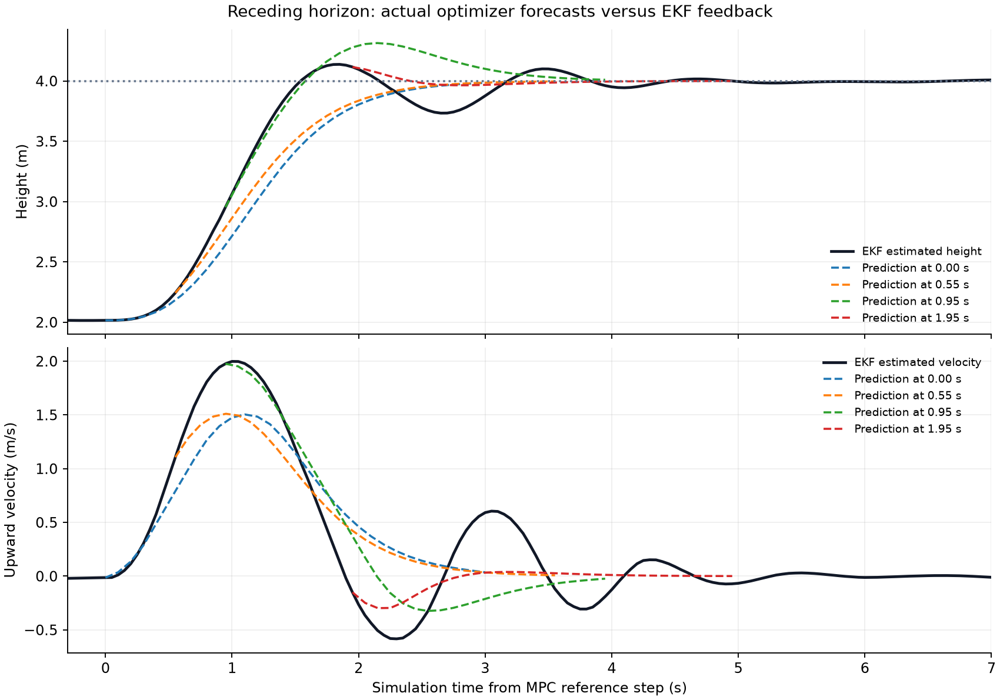
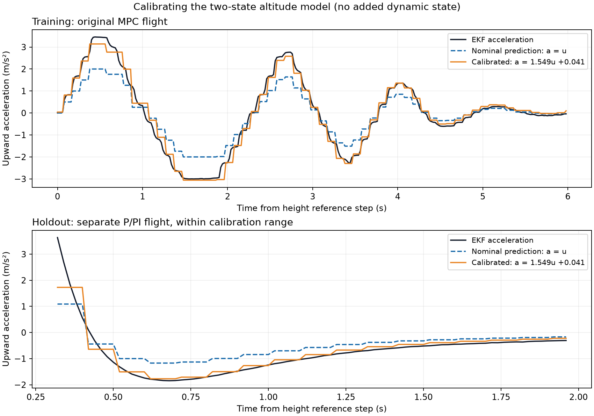
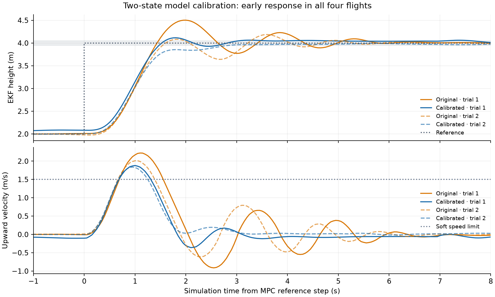
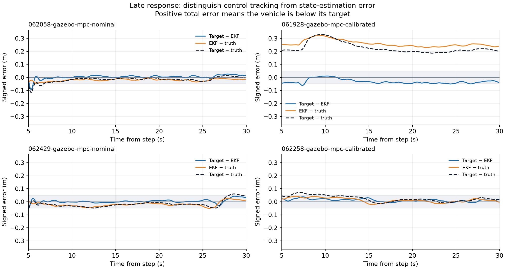
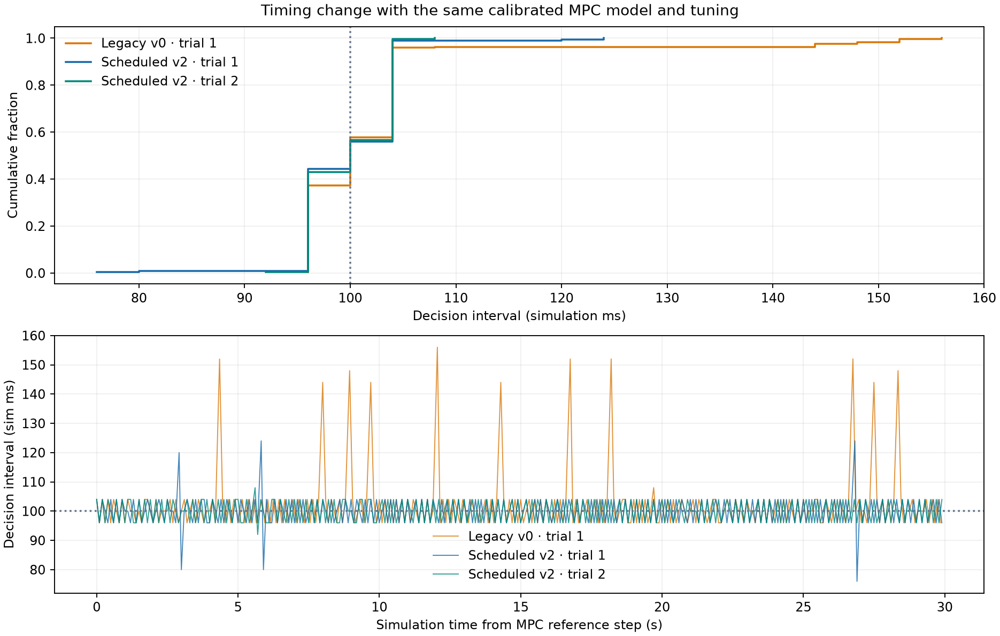
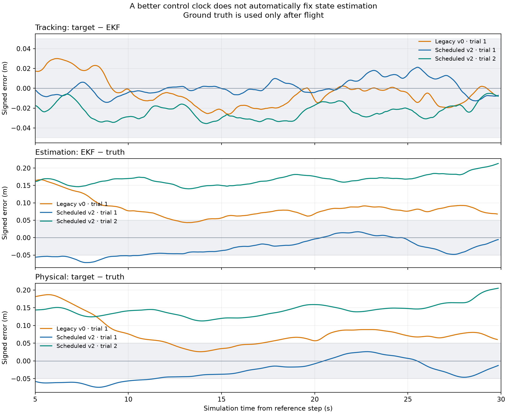
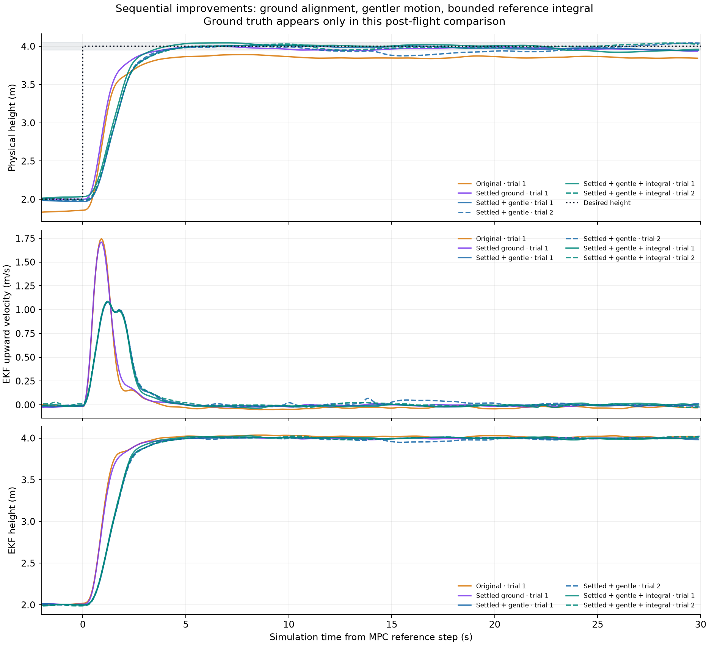

# 首次正式实验结果：高度 2 m → 4 m

实验日期：2026-10-26（北京时间）。运行环境为 Mac 上 UTM 的 Ubuntu 24.04 ARM64；PX4 v1.17.0，SIH Quadrotor X 六自由度仿真。

已完成起飞、2 m 稳定悬停、4 m 目标阶跃、30 秒仿真时间观察、降落和自动解除电机解锁。分析还核对了 ULog：阶跃观察期间一直处于 Offboard 且电机保持解锁，结束时落地并解除解锁。ULog 记录的丢数据次数为 0。

## 实测指标

指标时间均为仿真时间。除明确标注真值的项目外，使用 PX4 估计高度计算。

| 指标 | 结果 |
|---|---:|
| 目标高度 | 2 m → 4 m |
| 阶跃前最后 2 秒估计高度均值 | 1.915 m |
| 10%–90% 上升时间（2.2 m → 3.8 m 首次向上穿越） | 1.328 s |
| 最大估计高度超调 | 0.151 m |
| 超调占 2 m 指令阶跃幅度 | 7.55% |
| 峰值估计上升速度 | 1.491 m/s |
| 观察末段最后 2 秒估计高度均值 | 4.046 m |
| 同期仿真真值高度均值 | 4.262 m |
| 同期估计高度减真值 | -0.217 m |
| 持续保持在目标 ±5 cm 内 | 本次观察窗口内未达到 |

30 秒为控制脚本保持目标的时间。指标按内部目标首次被日志记录的时刻对齐，并排除降落边界前 0.1 秒，因此用于统计的阶跃后窗口为 29.856 秒。

## 串级控制响应分析

1. **第一张图：位置误差。** 橙色目标从 2 m 跳到 4 m。蓝线是控制器实际使用的 EKF 估计高度；绿色是 SIH 动力学真值。两者分别以起飞前地面为零点。控制器不会直接读取绿色真值作为反馈。
2. **第二张图：位置环输出速度目标。** 本次 MPC_Z_P=1，约 2 m 的高度误差对应约 2 m/s 的向上速度目标。随着高度接近目标，这个速度目标下降。
3. **第三张图：速度环输出加速度目标。** 实际速度暂时跟不上目标，速度误差带来较大的加速度需求。接近目标时，加速度需求下降并可变为负值，用来减速。图中的估计加速度含噪声。
4. **第四张图：推力变化。** 推力先增大，使无人机上升；随后减小以减速，最后回到悬停附近。纵轴是归一化指令，不是牛顿。悬停时即使净加速度为零，也需要推力抵消重力。

这次竖直速度环增益为 P=4、I=2、D=0，因此是 PI 在起作用；位置环是 P。MPC_USE_HTE=1，悬停推力估计器启用。其余实际参数在 parameters.json 中保留。

## 如何解读误差

平均估计高度接近 4 m，不等于真实高度恰好为 4 m。末段真值与估计值相差约 22 cm；即使扣除了起飞前的原点偏移，两者仍有动态差异。仿真包含传感器噪声和状态估计。该结果表明，必须分别评价“控制器对估计状态的跟踪”与“真实物理状态的准确性”；本实验未单独辨识误差来源，不能把全部差异归因于某一个传感器。

本次也没有持续保持在 ±5 cm 误差带内，因此不应宣称厘米级稳定悬停。不要只用最后一个点或最后 2 秒均值代替整段响应。

## 控制实现与数据来源

- [位置 P、速度 PID 与推力转换](vendor/PX4-Autopilot/src/modules/mc_pos_control/PositionControl/PositionControl.cpp)：先找 _positionControl，再找 _velocityControl 和 _accelerationControl。
- [位置与速度增益定义](vendor/PX4-Autopilot/src/modules/mc_pos_control/multicopter_position_control_gain_params.c)。
- [原始日志与导出结果](results/20261026-165925-ground-relative/)。
- [完整实验说明与重跑方法](README.md)。

上述首次 SIH 实验只做基线，未改变控制器增益；记录继续保留作历史对照。后续一维 MPC 使用下面的新 Gazebo 对照组。

## 一维高度 MPC：首个完整 Gazebo 对比

实验日期：2026-10-27（北京时间）。PX4 v1.17.0、Gazebo Harmonic X500、Ogre 2 软件 GUI。两个正式对照试验都重启项目专用 Gazebo 服务器与 GUI，从全新场景开始；导出的 PX4 控制参数相同。所有指标时间为仿真时间，两次记录均无 ULog 丢数据，均确认降落、自动停桨。

MPC 使用高度和速度双积分模型，名义 10 Hz 更新、预测 3 s；速度为软约束，加速度及相邻指令变化为硬约束。起飞/降落仍由原 PX4 控制器完成，2 m 悬停后接管。原始 ULog 确认 MPC 期间竖直位置/速度目标为 NaN、加速度目标有效，原竖直 P/PI 反馈未参与。

| 指标 | PX4 P/PI 基线 | 一维 MPC |
|---|---:|---:|
| 10–90% 上升时间 | 2.104 s | 0.868 s |
| 估计高度超调 | 0.0288 m | 0.1383 m |
| 持续进入 ±5 cm 误差带 | 3.740 s | 4.184 s |
| 末段估计高度均值 | 3.9997 m | 3.9666 m |
| 末段真值高度均值 | 3.9263 m | 3.8649 m |
| 峰值估计向上速度 | 1.724 m/s | 2.002 m/s |

这版 MPC 首次到达目标更快，但超调和振荡更大，最终估计高度还有约 3.3 cm 偏差；持续进入 ±5 cm 误差带的时间也略长于基线。两种控制律的整定和约束不同，且各只有一次正式对照，不能据此宣称 MPC 普遍优于 PID。

1.5 m/s 是软预测速度限制，实际峰值 2.002 m/s。优化器最大预测速度 slack 为 0.452 m/s；实际加速度也可能超过 ±2 m/s² 的指令限制，因为动力学模型只是近似。最大求解耗时 4.68 ms，95% 求解耗时不超过 1.78 ms，最大实际更新间隔 0.156 s。命令与约束的数值残差最大约 1.7e-06。

黑线是 EKF 估计反馈，虚线取自 0、约 0.5、1、2 s 时真实求解出的未来轨迹。最初预测低估了实际上升速度，随后预测不断用新状态修正；这正是下一阶段辨识执行动态、改进预测模型的依据。当前没有积分或扰动观测器，估计状态跟踪与物理真值精度也需要分开看。

调试中保留了以下记录，未混入正式对照：

- 20261027-000330-mpc-sih-check：未加载 ROS 库路径，PX4 二进制没有启动；入口脚本已补上环境加载。
- 20261027-000351-mpc-sih-check：早期名义 MPC 在 SIH 中完成飞行，存在残余误差；后续速度软约束版本以 Gazebo 正式记录为准。
- 20261027-000917-gazebo-mpc：复用旧场景时在原控制器起飞阶段就出现估计/真值严重不一致，尚未接管 MPC，已标记失败；上游根因未锁定，启动器现每次重建场景。
- 20261027-001225-gazebo-mpc：早期速度硬约束版本因模型误差导致 QP 无解，按逻辑退出并降落；随后改为显式速度软约束。

正式记录：[P/PI 基线](results/20261027-001613-gazebo-pid/)、[MPC](results/20261027-001439-gazebo-mpc/)、[对比数据](results/20261027-mpc-comparison/comparison.json)。实现入口为 scripts/altitude_mpc.py，运行和参数说明见 README.md。数值行为测试覆盖悬停平衡、完整高度阶跃及约束、下降方向、非法输入和超速状态的软约束恢复。

## 二阶模型校准：增益与偏差修正

2026-10-27 后续实验保留 `[h,v]` 两个状态，把 `v_dot=u` 改为 `v_dot=1.549265*u+0.041090`，没有加入加速度状态或人为延迟。系数只从旧 MPC 记录的前 6 秒拟合，然后冻结。输入代价围绕模型悬停平衡 `u=-b/K=-0.02652 m/s²` 计算，末端 LQR 矩阵按新模型自动重算；阶段权重、预测步长、时域、速度软约束和输入硬约束保持不变。

使用独立旧 P/PI 记录验证，加速度映射 RMSE 从 0.5275 降至 0.3086 m/s²；0.2 s 速度增量预测 RMSE 从 0.04296 降至 0.01361 m/s。非负延迟扫描在训练集上以零延迟最优，但反馈滤波和时间戳对齐可能掩盖物理延迟，因此不能据此断言执行器没有滞后。

每个模型随后各进行两次全新 Gazebo 场景飞行，系数不再重新拟合，所有计划的试验均纳入下表。全部完成 30 秒阶跃观察、降落和自动解除解锁，均无 ULog 丢数据；原竖直 P/PI 旁路检查通过，导出的 PX4 参数与 MPC 整定一致。

| 模型/试验 | 上升时间 s | 超调 cm | 持续进入 ±5 cm 的时间 s | 末段估计误差 cm | 末段真值高度 m |
|---|---:|---:|---:|---:|---:|
| 原模型 / 062058 | 0.784 | 50.33 | 5.556 | +1.98 | 3.9944 |
| 校准模型 / 061928 | 0.904 | 11.58 | 24.468 | -2.95 | 3.7873 |
| 原模型 / 062429 | 0.852 | 18.69 | 5.052 | +3.65 | 3.9470 |
| 校准模型 / 062258 | 1.036 | 0.76 | 2.860 | +1.29 | 3.9782 |

正误差表示估计高度低于 4 m。各模型只有两次试验，且传感器/估计器状态与更新抖动未严格控制，不能把全部差异归因于模型。原模型两次最大更新间隔分别约 0.196、0.152 s，校准模型两次均约 0.152 s；一次原模型的较大超调也可能受到较长更新间隔影响。

平均估计高度超调从 34.51 cm 降至 6.17 cm，平均上升时间从 0.818 s 增加到 0.970 s，峰值估计速度均值从 2.118 降至 1.859 m/s。新飞行的独立预测评分也支持固定校准系数：原模型新飞行上，加速度 RMSE 从 0.7754 降至 0.3430 m/s²；校准模型新飞行上，从 0.5603 降至 0.2393 m/s²。均未用这些新飞行重拟合。

稳定时间并没有一致改善。第一次校准飞行的估计高度曾长期略高于误差带，24.47 s 才持续进入；第二次为 2.86 s。其末段估计高度与真值分别相差约 24.2 cm、0.9 cm，说明估计误差仍是独立问题。当前固定加速度偏差参数不能消除所有估计偏差，也没有积分或扰动观测器。1.5 m/s 仍是软限制，校准版实际峰值仍达到约 1.84–1.88 m/s。

完整 30 秒响应见 [四次完整曲线](results/20261027-model-calibration-comparison/mpc-model-comparison.png)，预测轨迹见 [模型前后预测](results/20261027-model-calibration-comparison/mpc-model-forecasts.png)。数值结果与条件核对见 [comparison.json](results/20261027-model-calibration-comparison/comparison.json)。

实现保留 nominal/calibrated 两种模式。Gazebo 默认校准模式；SIH 默认原模型，并拒绝使用这份 X500 校准配置。数值检查包括校准模型的悬停平衡、完整阶跃和非法增益，另验证了跨模拟器配置误用会在启动前被拒绝。原始 ULog、每次完整预测、实际模型配置副本与代码快照均保留。

## 时序审计与跟踪/估计误差分解

2026-10-27 本轮先检查此前四次模型对比，再用同一份校准模型做调度对照。三个误差使用相同固定地面基准，按逐样本恒等式核对：

    跟踪误差 = 目标 - EKF
    估计误差 = EKF - 真值
    物理误差 = 跟踪误差 + 估计误差

此前 061928 那次校准飞行末段的跟踪误差约 -2.95 cm、估计误差约 +24.27 cm、物理误差约 +21.31 cm。末段 EKF 竖直速度均值约 -0.050 m/s，而估计高度斜率只有约 -0.002 m/s，反馈状态并不完全符合简单双积分模型的稳态假设。在从地面标定到降落指令发出前，所检查的相关记录都没有 z_reset_counter 变化，未发现飞行中的高度坐标重置。漂移或融合偏差的上游来源尚未锁定。

旧程序在发送设定值后才清空接收队列，求解又受墙上时间的 50 ms 发送门控约束，并以最近一次状态时刻重新计算下次间隔，容易积累相位漂移。新程序优先读取状态，使用固定相位的 0.1 s 仿真时间节拍；求解后立即发送，写日志放在发送之后；位置遥测请求从 20 Hz 提至 50 Hz。这是一组时序/反馈采样改动，不能把效果单独归因于其中一项。

初版新调度的两次试验为 091027、091328。最大间隔均为 120 ms，但典型间隔常在 80/120 ms 交替，95 分位为 120 ms，比本轮旧调度的 104 ms 更差。初版结果及源文件保存在 results/20261027-timing-comparison，没有删除或混入最终版本统计。

最终版本允许使用比节拍早最多 4 ms 的已收到状态，保持计划节拍相位不漂移，也不在过载后补算过时指令。有符号相位误差另行保存。下表的间隔全部为仿真时间，求解耗时与本地发送时间则为墙上时间。

| 调度/记录 | 平均间隔 ms | 95分位 ms | 最大间隔 ms | 超过120 ms的间隔数 | ±5 cm稳定时间 s |
|---|---:|---:|---:|---:|---:|
| 旧调度 / 091157 | 101.878 | 104.0 | 156.0 | 11 | 2.720 |
| 新调度 v2 / 091822 | 100.000 | 104.0 | 124.0 | 2 | 3.104 |
| 新调度 v2 / 091953 | 100.013 | 104.0 | 108.0 | 0 | 2.532 |

最终版本两次均没有跳过控制节拍，反馈采样间隔中位数约 20 ms（95 分位 24 ms），旧调度为约 48 ms（95 分位 56 ms）。新版本的本地状态年龄——从本进程收到状态到实际发出指令——中位数约 0.49、0.54 ms，95 分位约 0.87、1.04 ms。这不是端到端延迟：消息进入接收队列以前的传输、估计器内部年龄仍不包含在内。也不能因此宣称硬实时保证。

| 调度/记录 | 末段跟踪误差 cm | 末段估计误差 cm | 末段物理误差 cm |
|---|---:|---:|---:|
| 旧调度 / 091157 | -0.54 | +7.99 | +7.44 |
| 新调度 v2 / 091822 | -0.87 | -2.41 | -3.28 |
| 新调度 v2 / 091953 | -1.32 | +19.88 | +18.56 |

时序的较长间隔得到改善，但控制精度并非所有指标都更好。本次旧调度也在 2.72 s 进入估计高度的 ±5 cm 带，新调度为 3.10、2.53 s；小样本且传感器/估计器初态不同，不能宣称确定的稳定时间收益。新调度第二次的估计高度接近 4.01 m、真值约 3.81 m，仍存在约 20 cm 的估计偏差。因此本轮不加积分/扰动观测器，下一步应检查高度融合和漂移来源；不能用仿真真值直接给 MPC 打补丁。

三次最终对照均确认全程竖直加速度接口、正常落地和停桨，且无 ULog 丢数据。两次初版试验也完整保留。本轮新增测试包括三个节拍行为检查和一个假连接时序/指令检查，均通过。默认启用 scheduled v2，legacy 可用于回归；模型比较脚本会拒绝把调度与反馈频率变化误报为模型变化。完整记录见 [时序对比 JSON](results/20261027-timing-refined-comparison/comparison.json)。结束后世界保持暂停。

## 顺序完成三项飞行质量优化

2026-10-27 本轮按“地面高度基准 → 温和动作 → 尾差补偿”顺序完成六次实际 Gazebo 飞行。原流程对照和仅改地面准备各一次，温和动作且不补偿两次，温和动作加外部慢积分两次。全部数据保留，未使用仿真真值作为任何在线反馈；所有试验的 EKF 初始参数一致，传感器噪声及 PX4 控制源码未修改。

### 1. 先等估计收敛，再记录地面

原流程只固定等待约 15 s，然后取最后 3 s 的局部高度中位数。在一些历史记录中，飞机停在地面时，EKF 竖直速度仍达到约 0.176 m/s，而后续融合过程还在修正高度；过早固定地面零点会把这段尚未收敛的偏差带入整次相对高度实验。它能解释本实验误差的一部分，不意味着所有估计漂移的上游原因已经锁定。

新 settled 流程至少观察 40 s；最近 10 s 的高度标准差 ≤2.5 cm、漂移率 ≤2.5 mm/s、竖直速度均值绝对值 ≤1.5 cm/s、速度 RMS ≤3.5 cm/s，并连续通过 3 s，之后才记录最后 3 s 的地面中位数。超时则不开始飞行。本轮实际通过时间分别记录在下表；代价是地面准备更久。

### 2. 降低接管后的动作强度

保留同一二阶校准模型、相同代价权重和名义 10 Hz 预测调度，只把速度软限制由 ±1.5 降至 ±1 m/s，加速度指令硬限制由 ±2 降至 ±0.8 m/s²，名义 jerk 由 5 降至 2 m/s³。起飞与降落仍由原 PX4 控制器完成，修改影响接管后的高度阶跃。

### 3. 实现并验证小幅尾差补偿

增加可选外部慢积分参考修正，积分增益 0.15/s，参考偏移上限 ±12 cm；仅在误差 <15 cm、速度 <15 cm/s 且输入未饱和时累计，目标变化时清零。真实目标始终是 4 m；修正后的优化器参考另存字段，不会把修正后的目标当作评分目标。它不修正 EKF 高度偏差，也不是完整 offset-free MPC。

开启/关闭各跑两次。补偿组的过渡累计误差有一定改善，但末段真实高度精度没有一致增益，物理超调均值还略大；因此当前默认保留 settled + gentle，补偿 off，integral 留作可选实验。

| 记录 | 地面准备 s | 配置 | 末段真值高度 m | 末段真实误差 cm | 真实峰值速度 m/s | 真实 ±5cm 稳定时间 s |
|---|---:|---|---:|---:|---:|---:|
| 093754 | 15.00 | 原流程 | 3.8463 | +15.37 | 1.742 | 未达到 |
| 095927 | 53.05 | 稳定地面/标准动作 | 3.9413 | +5.87 | 1.696 | 未达到 |
| 101018 | 80.92 | 稳定地面/温和/补偿关 | 3.9470 | +5.30 | 1.068 | 未达到 |
| 101256 | 43.10 | 稳定地面/温和/补偿关 | 4.0355 | -3.55 | 1.057 | 23.27 |
| 101456 | 120.18 | 稳定地面/温和/补偿开 | 3.9487 | +5.13 | 1.089 | 未达到 |
| 101813 | 47.28 | 稳定地面/温和/补偿开 | 4.0376 | -3.76 | 1.052 | 12.91 |

误差正值表示真实高度低于 4 m。温和、无补偿两次的平均末段真实高度绝对误差为 4.42 cm，原流程对照为 15.37 cm；平均真实速度峰值从 1.742 降至 1.063 m/s。末段高度更接近目标，动作更温和，但上升变慢，且两次只有一次在观察窗口内持续保持真实 ±5 cm，不能宣称已经实现可靠的厘米级悬停。

积分组平均末段真实绝对误差为 4.44 cm，与关闭时几乎相同；物理超调均值为 4.33 cm，关闭时为 2.90 cm。积分候选完整保留，并未因其不是最终默认配置而删掉。

以上为小样本分阶段试验，噪声和初始化过程没有固定随机种子，也不能把不同试验的全部差异归因于单一改动。EKF 参数相同由原始 ULog 核对，真值的地面基准同样取对应起飞前最后 3 s。物理稳定时间用原始真值样本计算，要求后续不再离开误差带且余下至少 2 s；不能用末段均值代替。

新增测试通过：稳定地面与漂移/速度异常的区分；积分门控、限幅、目标切换清零；相同未建模常值扰动下外部积分减少稳态残差；修改后仍保持先接收、再求解、再发出正确加速度指令。全部飞行均正常落地与停桨，阶跃期间竖直 P/PI 旁路由 ULog 核对。

当前默认：`run-on-vm.sh gazebo mpc calibrated scheduled settled gentle off`。完整指标、所有候选及所选默认配置见 [comparison.json](results/20261027-flight-quality-pipeline/comparison.json)。本轮结束时仿真保持暂停。
